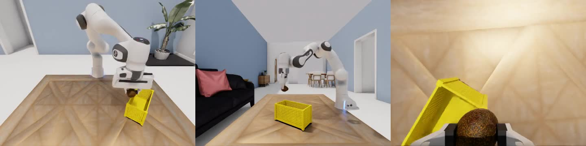

# DynamicVLA-IsaacSim61

English | [简体中文](README.zh-CN.md)

An **unofficial Isaac Sim 6.1 compatibility port** of [DynamicVLA](https://github.com/hzxie/DynamicVLA). This repository focuses on simulator migration, practical setup, and a real runtime demonstration—not a new policy or an official upstream release.

**Status: single-environment GPU smoke-tested. Not a reproduction of the paper's benchmark success rate.**

## Real runtime demo

[](assets/demo/clean610-avocado-demo.mp4)

[Watch the 10-second demo](assets/demo/clean610-avocado-demo.mp4)

Recorded on 2026-10-11 from this isolated compatibility snapshot: official DynamicVLA DOM weights, Franka, one environment, original streaming LAAS and sleep. The first complete episode of two consecutive smoke episodes is shown (2/2 placement successes). Playback is 24 fps; this is **not wall-clock latency evidence or an overall success-rate estimate**. See [VALIDATION.md](VALIDATION.md) for source/checkpoint hashes and validation limits.

## What this port changes

Based on upstream commit `434dc7105cf6d559018d15af5fecbcdad44f036e`.

- Adapts simulator-facing quaternion boundaries, Warp state materialization, camera serialization, PhysX configuration, task imports, controller inputs, and startup order.
- Keeps model, training, dataset, and inference implementations unchanged from the pinned upstream snapshot.
- Retains original action queue, inference wait, reset/ACK behavior, and gripper parameters.
- Does not bundle private experiment runners, checkpoints, robot meshes, or benchmark assets.

See [MIGRATION.md](MIGRATION.md) for implementation notes.

## Tested environment

| Component | Version / scope |
| --- | --- |
| OS / simulator Python | Linux / Python 3.12 |
| Isaac Sim | 6.1.0.0 |
| Isaac Lab | 3.0.0rc1, PhysX backend |
| Robot / environments | Franka / 1 |
| Policy | Official DynamicVLA DOM checkpoint |

Keep simulation and inference in **separate Python environments**, preferably on separate visible GPUs. This early-release API target does not guarantee compatibility with every later Lab 3.x release.

## Quick start

### 1. Install environments and obtain resources

Install the pinned Isaac stack through NVIDIA's installation procedure and complete license acceptance. Add `shapely pyzmq h5py` in the simulator environment. For the separate model environment, follow the model setup in [README.upstream.md](README.upstream.md); do not install model dependencies indiscriminately into the simulator environment.

Download separately:

- [DOM testing configurations and scene subset](https://gateway.infinitescript.com/?f=DOM-Test)
- [DOM 3D objects](https://gateway.infinitescript.com/?f=DOM-3D-Objects)
- [Full DOM scenes](https://gateway.infinitescript.com/?f=DOM-3D-Scenes), if needed
- [Official DOM checkpoint](https://huggingface.co/hzxie/dynamic-vla-DOM)

Test-list paths must resolve from the working directory; absolute paths are recommended.

### 2. Start simulation

From this repository in the simulator environment:

```bash
HEADLESS=1 ENABLE_CAMERAS=1 python simulations/evaluate.py --num_envs 1 \
  --scene_dir /path/to/scenes --object_dir /path/to/objects \
  --env_cfg /path/to/test-envs.txt --output_dir /path/to/results \
  -n 20 --save
```

`-n 20` runs 20 trials per configuration; `--save` saves videos. **This target does not accept the old `--headless` flag; use `HEADLESS=1`.** Cameras are enabled in AppLauncher, so the old camera CLI flag is unnecessary.

### 3. Start inference

In a separate terminal and model environment:

```bash
python scripts/inference.py -p /path/to/official-checkpoint -r euler -d -s
```

These flags select Euler rotations, delta actions, and contiguous inference. Keep communication on trusted loopback: the inherited Python-object deserialization protocol is unsafe on untrusted networks.

More setup details: [PORT_README.md](PORT_README.md).

## Validation and limitations

Startup, RGB observations, real inference, natural termination, full video decoding, and second-episode reset passed a limited smoke check. Eight CPU boundary tests also passed:

```bash
python -B -m unittest discover -s tests -v
```

This does **not** establish overall benchmark success rate, independent physical initial-state coverage, correct per-environment accounting for the inherited multi-environment option, dataset generation, Piper support, or cross-version contact equivalence.

The paper reference environment is Sim 4.5 / Lab 2.2.1, not this port. Original Franka gripper parameters are unchanged; later upstream gripper corrections are not incorporated. The tested installation used the Franka 5.1 content URL prefix with the 6.1 runtime; check asset availability on your installation. Queue/reset warnings are retained in [VALIDATION.md](VALIDATION.md), not silently presented as fixed.

## Documentation

- [中文说明](README.zh-CN.md)
- [Port setup and version boundaries](PORT_README.md)
- [Migration notes](MIGRATION.md)
- [Runtime validation](VALIDATION.md)
- [Release checklist](RELEASE_CHECKLIST.md)
- [Preserved upstream README](README.upstream.md): model/training/data-generation reference; its simulator instructions target upstream versions, not this 6.1 port.

## Credits and citation

Original DynamicVLA authors: Haozhe Xie, Beichen Wen, Jiarui Zheng, Zhaoxi Chen, Fangzhou Hong, Haiwen Diao, and Ziwei Liu, S-Lab, Nanyang Technological University. This repository provides compatibility work around their implementation; no original-author or NVIDIA endorsement is implied.

Upstream citation:

```bibtex
@inproceedings{xie2026dynamicvla,
  title     = {{DynamicVLA:} A Vision-Language-Action Model for Dynamic Object Manipulation},
  author    = {Xie, Haozhe and Wen, Beichen and Zheng, Jiarui and Chen, Zhaoxi and Hong, Fangzhou and Diao, Haiwen and Liu, Ziwei},
  booktitle = {NeurIPS},
  year      = {2026}
}
```

## License

The original [NTU S-Lab License 1.0](LICENSE), including its **non-commercial restriction**, is retained. This is not MIT/Apache relicensing. Simulator software, datasets, and assets have separate terms and are obtained externally. For commercial permissions, contact the relevant original rights holders.
